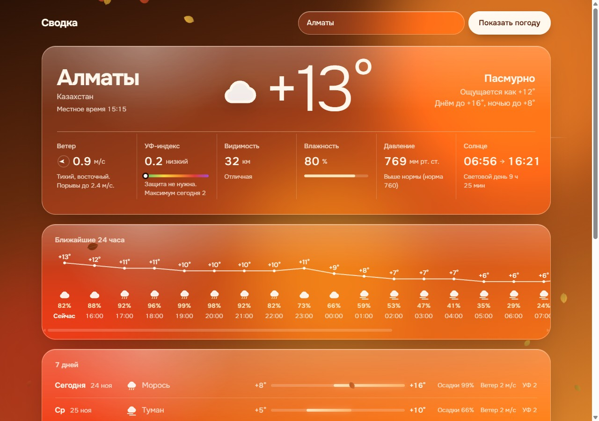
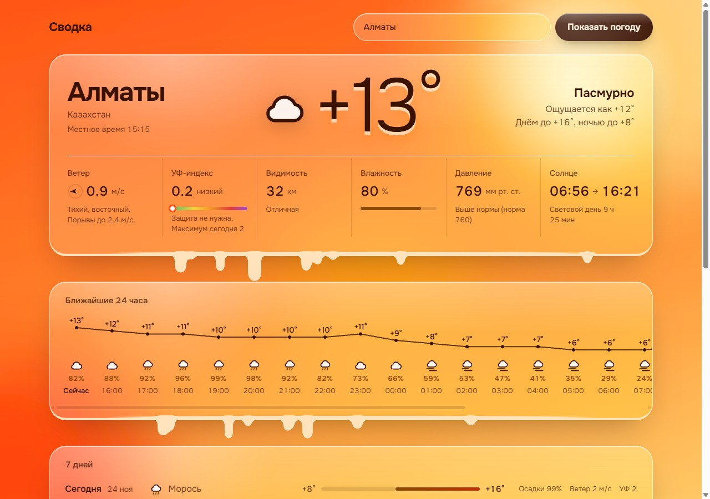
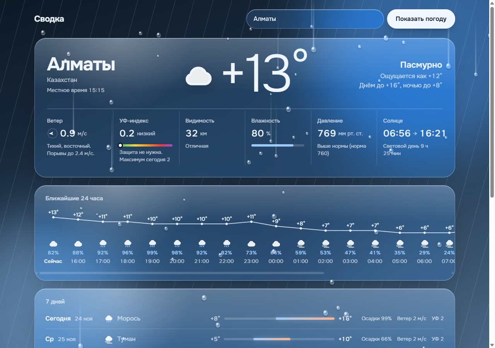
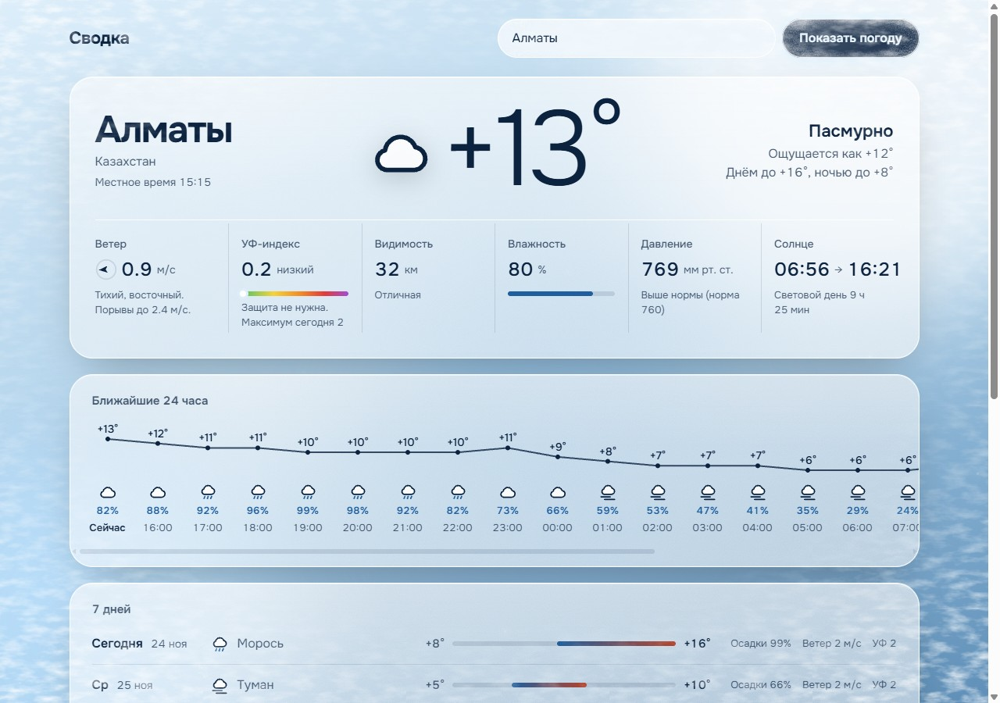
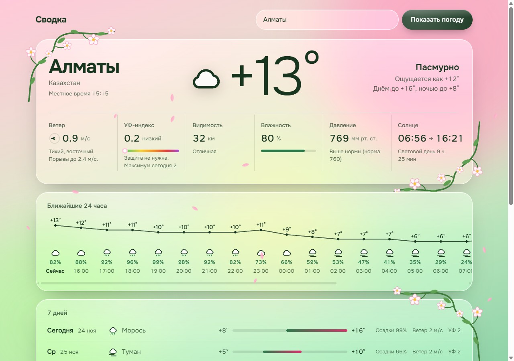
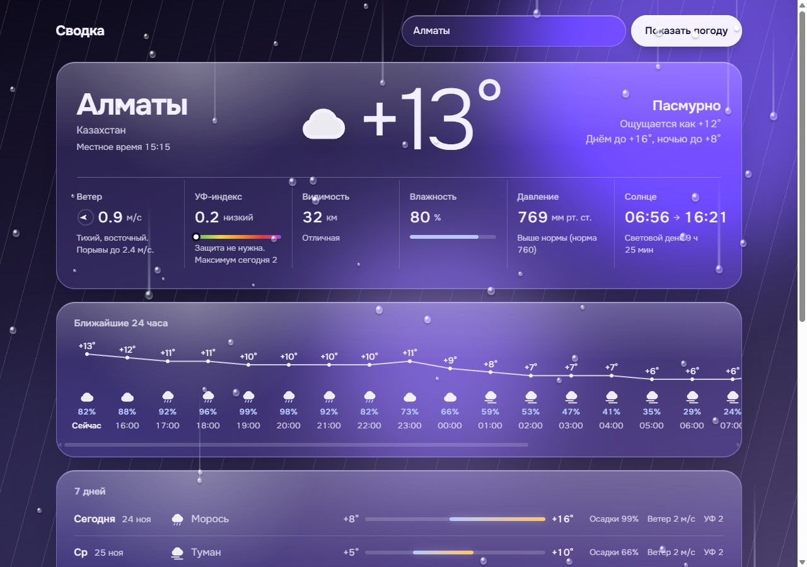
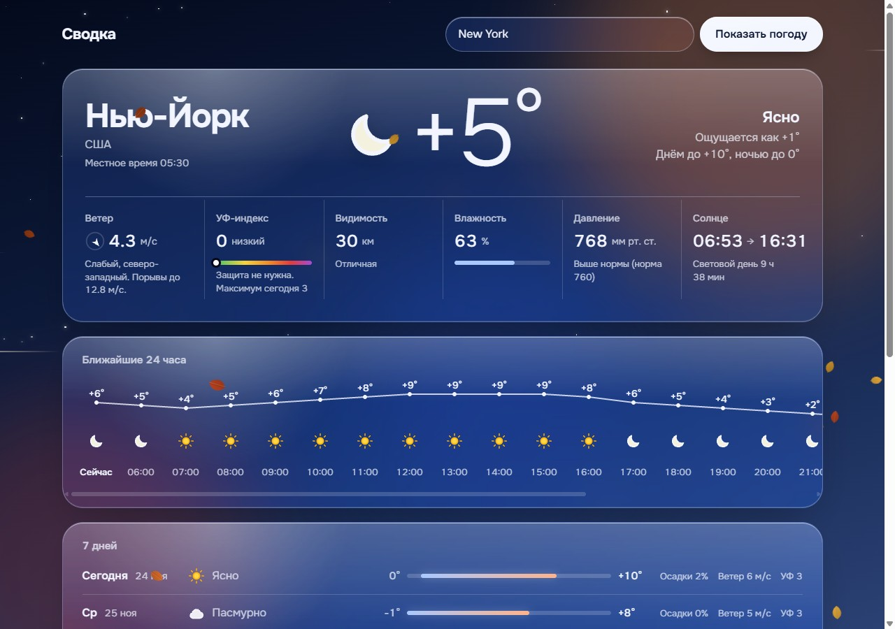
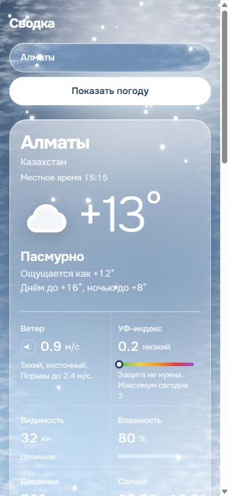
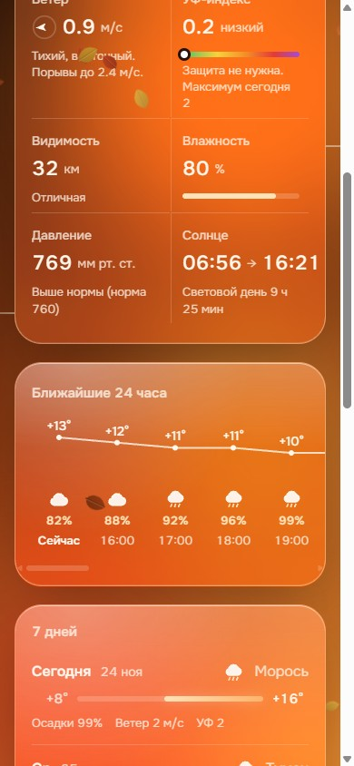

<div align="center">

# Сводка

**Прогноз погоды на Laravel и Open-Meteo. Интерфейс в стиле liquid glass меняется вместе с погодой за окном.**

Laravel 13 · PHP 8.3 · SQLite · без сборки фронтенда · 15 тестов



</div>

Учебный проект по ПМ01. Задание: выбрать API из списка [public-apis](https://github.com/public-apis/public-apis) и сделать к нему проект на Laravel.

## Что показывает

| Блок | Что внутри |
|---|---|
| **Сейчас** | Температура, ощущается как, днём и ночью, местное время города |
| **Ветер** | Скорость, сила словами по шкале Бофорта («тихий», «свежий»), направление и стрелка компаса, порывы |
| **УФ-индекс** | Значение, уровень по шкале ВОЗ, цветная шкала, совет («нужны крем и очки»), максимум за день |
| **Видимость** | В километрах и словами: от «очень плохая, туман» до «отличная» |
| **Влажность и давление** | Давление в мм рт. ст. и сравнение с нормой 760 |
| **Солнце** | Восход, закат, длина светового дня |
| **24 часа** | Линия температуры, значок погоды (днём солнце, ночью луна), вероятность осадков |
| **7 дней** | Полоски температур на одной шкале: сразу видно, какой день теплее. Осадки, ветер, УФ |
| **История** | «Недавно искали»: повторный поиск того же города увеличивает счётчик, дубли не создаются |
| **JSON API** | `GET /api/weather?city=Алматы` |

## Оформление под погоду

Тема выбирается сама. Сначала смотрим, что за окном (гроза, снег, дождь, туман), затем температуру, затем время года. В южном полушарии времена года наоборот. Ночью небо темнеет, при ясной погоде появляются звёзды.

| | |
|---|---|
|  **Жара, от +25°.** Панели плавятся и стекают каплями, воздух дрожит от марева. |  **Дождь.** Капли сидят на стекле и стекают по интерфейсу со следом. |
|  **Мороз, от 0° и ниже.** Стекло матовое, кнопки и поле поиска в инее, углы экрана замерзают. |  **Весна.** Углы панелей обвивают ветки, цветы распускаются при загрузке, падают лепестки. |
|  **Гроза.** Ливень и вспышки молний. |  **Ночь.** Тёмное небо, звёзды, луна вместо солнца. |

Ещё есть темы «Лето» (солнечный блик и пылинки), «Осень» (листья летят по ветру, а скорость ветра берётся из прогноза), «Зима», «Снег» и «Туман».

Для показа тему можно выбрать вручную внизу страницы или через адрес: `/?city=Алматы&theme=rain`.

<p align="center">
  
  &nbsp;&nbsp;
  
</p>

Эффекты не мешают пользоваться страницей: они не перехватывают клики, а при включённой в системе настройке «уменьшить движение» останавливаются.

## Почему Open-Meteo

- Есть в public-apis, раздел Weather: `Auth: No`, `HTTPS: Yes`, `CORS: Yes`.
- Ключ и регистрация не нужны, проект запускается на любом компьютере без настройки.
- Два API: Geocoding (город → координаты, понимает русский) и Forecast (координаты → прогноз).
- Бесплатно для некоммерческого использования, данные по лицензии CC BY 4.0.

## Запуск

**Windows:** дважды щёлкнуть `start.bat`. Скрипт сам:

1. найдёт PHP 8.3 или скачает переносной;
2. скачает composer.phar и поставит пакеты;
3. создаст `.env` и ключ;
4. создаст базу SQLite и применит миграции;
5. запустит сайт на первом свободном порту от 8000 и откроет браузер.

**Вручную:**

```bash
composer install
cp .env.example .env
php artisan key:generate
php artisan migrate
php artisan serve
```

Нужен интернет: прогноз приходит с `api.open-meteo.com`.

## Если API не отвечает

| Слой | Как работает |
|---|---|
| Таймаут | Запрос ждёт не больше 5 секунд (`WEATHER_TIMEOUT`) |
| Повтор | При сбое запрос повторяется через 300 мс (`WEATHER_RETRIES`) |
| Кеш | Прогноз хранится 30 минут (`WEATHER_CACHE_MINUTES`), координаты городов месяц |
| Резервная копия | Последний удачный прогноз хранится без срока. Если API упал, сайт показывает его с пометкой «Open-Meteo не отвечает» |
| Понятная ошибка | Если копии нет, вместо ошибки 500 появляется «Прогноз недоступен» и кнопка «Попробовать снова». API отвечает `503` |

PHP для Windows не знает корневых сертификатов, и cURL падает с ошибкой 60. Поэтому подключён пакет `composer/ca-bundle`: он берёт системный список сертификатов, а если его нет, то свой.

## Маршруты

| Метод | Адрес | Ответ |
|---|---|---|
| GET | `/` | Страница. Без параметра город по умолчанию (`WEATHER_DEFAULT_CITY`, Костанай) |
| GET | `/?city=Алматы` | Прогноз для города и запись в историю |
| GET | `/?city=Алматы&theme=heat` | То же с выбранным оформлением |
| GET | `/api/weather?city=Алматы` | JSON: `city`, `forecast` (`source`, `current`, `hours`, `days`), `error`. Коды 200, 404, 422, 503 |

`forecast.source` показывает, откуда данные: `api` (только что из сети), `cache` (из кеша) или `stale` (сеть недоступна, старая копия).

## Тесты

```bash
php artisan test
```

15 тестов. Open-Meteo в них не вызывается: ответы подменены через `Http::fake`, а `Http::preventStrayRequests()` не даёт тестам уйти в сеть.

- Страница показывает погоду, ветер, УФ, видимость, давление, солнце и почасовой прогноз.
- Город записывается в историю. Второй запрос берётся из кеша без сети.
- При упавшем API показывается последний прогноз. Без кеша выводится понятная ошибка.
- Неизвестный город, длина названия, коды ответа JSON API.
- Выбор темы: жара от +25°, мороз от 0°, приоритет осадков, времена года в обоих полушариях, ручной выбор и защита от чужих значений.
- Перевод чисел в слова: УФ, видимость, ветер, стороны света, коды погоды WMO.

## Как устроено

| Файл | Роль |
|---|---|
| `app/Services/OpenMeteo.php` | Запросы к API, кеш, резервная копия |
| `app/Support/Theme.php` | Выбор оформления по погоде и сезону |
| `app/Support/Conditions.php` | УФ, видимость, ветер словами |
| `app/Support/WeatherCode.php` | Коды погоды WMO → русский текст и группа для значка |
| `resources/views/weather/` | Страница и слой эффектов |
| `public/css/app.css` | Стекло, темы и анимации, один файл без сборки |
